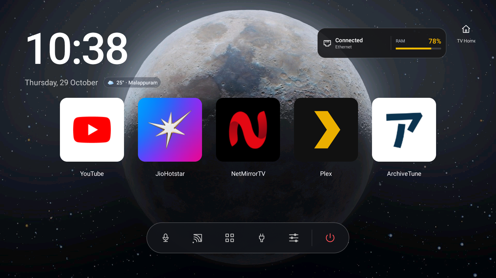
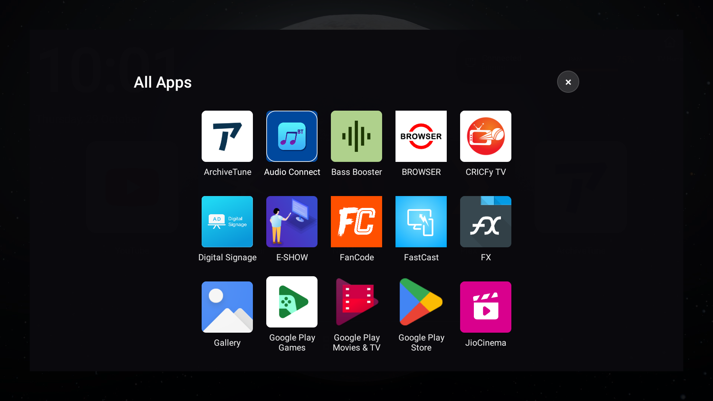
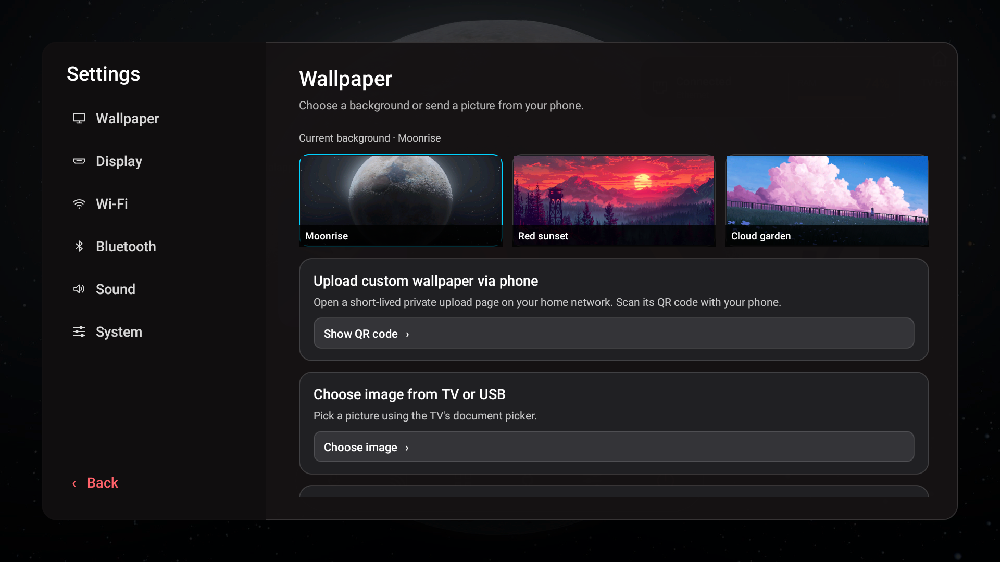
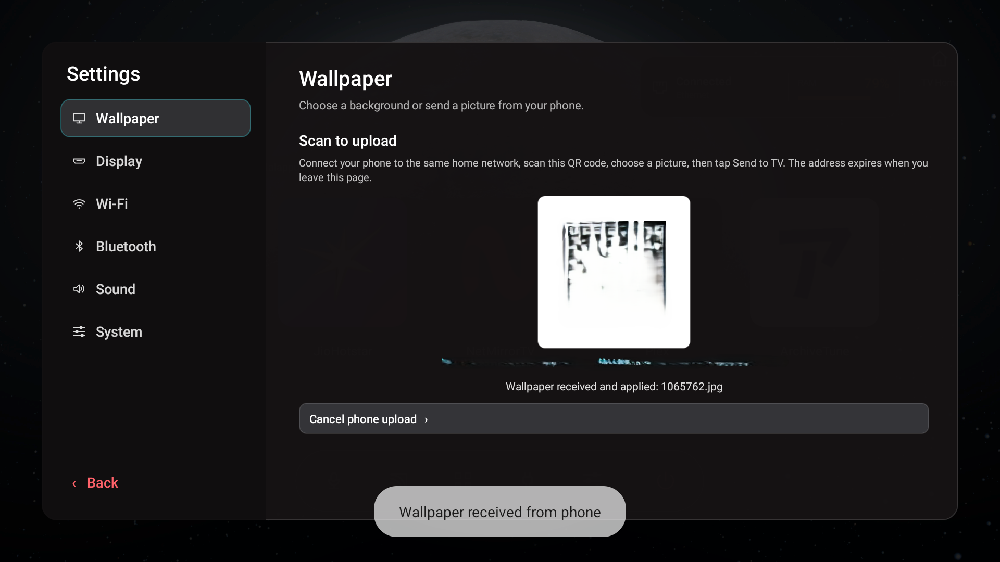

# TV Detox

A customizable home screen and setup toolkit for Android TV. It is designed for use with a local coding agent such as Codex, Gemini CLI, or Claude Code. The agent reads this project, asks which apps you want, and helps you set it up through ADB. The AI is not built into the TV app, and a browser-only chat cannot run commands on your computer.

Created and maintained by **Sreenand**, a 15-year-old who likes to make and break things. Based on the original TV Detox project by Ansub Khan.

## Watch the project

- [YouTube Short](https://www.youtube.com/shorts/UD2A4KC6pn0)
- [Instagram post](https://www.instagram.com/p/DfGrhvcyepY/)

## Screenshots

<table>
<tr>
<td align="center"><br>Home screen</td>
<td align="center"><br>All apps and D-pad navigation</td>
</tr>
<tr>
<td align="center"><br>Wallpaper settings</td>
<td align="center"><br>Phone wallpaper upload</td>
</tr>
</table>

## What it does

- Provides a D-pad-friendly Android TV home screen with a clock, app shortcuts, and settings shortcuts.
- Lets you choose the apps shown on the home screen during setup. The AI helper should ask you, identify installed app package names, show the final ordered list, then use only the list you approve.
- Includes wallpaper choices and a local-network phone upload flow.
- Uses standard Android APIs and ADB; rooting is not required.
- Includes an `undo.sh` script to re-enable packages disabled by this setup and remove TV Detox.

Compatibility depends on each TV maker's Android version and custom software. The manifest supports Android API 21 and newer, but that does not mean every TV supports every feature or behaves the same way. Check the TV's model and Android version before setup. Do not assume all settings shortcuts, HDMI reporting, or Home-button behavior work on every device.

## Set up with an AI coding agent

### 1. Prepare the computer and TV

On the computer, have Git, Java 17, Android SDK Platform 34, Android SDK Build Tools 34.0.0, and Android Platform Tools (`adb`) installed. On Windows, open the project in **Git Bash**. On macOS or Linux, use a terminal. Set `ANDROID_HOME` to your Android SDK folder if it is not detected automatically.

On the TV, enable Developer options and ADB debugging. The menu names differ by manufacturer; commonly, open **Settings → About** and select **Build** seven times, then enable debugging under **Developer options**. Find the TV's IP address in its network settings. Keep the computer and TV on the same local network.

### 2. Ask the agent to guide setup

Open this downloaded project in Codex, Gemini CLI, Claude Code, or another coding agent that can inspect local files and run terminal commands. Paste this instruction, filling in your TV details:

```text
Help me set up this TV Detox project on my Android TV.
Read AGENTS.md, README.md, install.sh, build.sh, and undo.sh first. My TV model is <brand/model>, Android version is <version>, and its IP address is <TV IP>.

Before changing the TV, explain what each planned command will do and ask for my confirmation. Do not root, unlock the bootloader, flash firmware, factory reset, clear app data, or uninstall/disable the TV maker's home app. Keep the original launcher available as a fallback. If anything is uncertain, stop and explain it.

Ask me which apps I want on the new home screen. Help me identify the package names of apps already installed on this TV, show me the ordered list, and wait for my approval. Do not use apps.txt as my personal selection. Do not disable any apps unless you first show me the exact package names, explain why, and get my approval.

Back up the current TV Detox APK if present, build from this repository, install using the approved app list, and explain how to run undo.sh. Do not reboot until I approve. After setup, show me how to turn ADB debugging off.
```

The agent should ask you to approve the TV changes. Read the package list and commands before approving. Keep ADB debugging off when you are not using it.

### 3. Build the app (optional)

From the repository folder in Git Bash or a macOS/Linux terminal:

```sh
sh build.sh
```

The APK is created at `out/tvhome.apk`. The build script uses `apps.txt` only as a generic fallback if no app list is supplied; it is not a recommended or personal selection. Keep private app lists, signing keys, APK backups, and TV-specific information out of this repository.

### 4. Install with your chosen apps

After the agent has identified and you have approved the package names, the installer can be run like this:

```sh
sh install.sh <TV_IP> "package.one,package.two,package.three"
```

For example, replace `<TV_IP>` and the package names with your own TV's address and the exact ordered list you approved. The installer uses `out/tvhome.apk` when it exists; otherwise it downloads the upstream project's latest release. It also performs TV configuration changes, including disabling certain packages, so inspect the script and review every proposed change before allowing it to run. ADB may show an authorization prompt on the TV; approve it only when you are ready.

### 5. Roll back

To restore packages this installer disabled and remove TV Detox, connect ADB and run:

```sh
sh undo.sh <TV_IP>
```

The TV must be on and reachable over ADB. If it is not reachable over Wi-Fi, use a supported USB ADB connection. The script keeps TV Detox installed if it cannot confirm that disabled packages were restored, so the TV still has a home screen while you retry. The original TV launcher is not uninstalled by this project. If you want it as a fallback, make sure it remains enabled; behavior varies by TV and setup.

## Help

- **ADB says unauthorized:** accept the debugging prompt on the TV, then retry.
- **ADB cannot connect:** check the IP, same network, TV power, and debugging setting. Some TVs require a different ADB pairing flow or do not permit network ADB.
- **A feature or key does not work:** TV makers customize Android. Share the TV model, Android version, and the exact behavior with your coding agent; do not ask it to disable more system packages as a guess.
- **Need to restore the TV:** run `sh undo.sh <TV_IP>` while ADB can reach it. If the launcher still behaves unexpectedly, use the TV maker's documented way to select its original home app.
- **Contributing:** open an issue or pull request with the TV model and Android version for device-specific reports. Do not include personal app lists, IP addresses, backups, account details, or signing keys.

## Repositories and licenses

- [Ansub/tv-detox](https://github.com/Ansub/tv-detox?tab=MIT-1-ov-file) — upstream TV Detox project. This repository retains its MIT license in [`LICENSE`](LICENSE); the original copyright notice is preserved.
- [ZXing/zxing](https://github.com/zxing/zxing) — QR-code encoder source subset is included under `libs/zxing-qr-src/`. Its Apache License 2.0 text is in [`libs/ZXing-LICENSE.txt`](libs/ZXing-LICENSE.txt), and source files retain their license headers.

The repository's `LICENSE` and third-party license notice describe the applicable terms. Please keep those notices with redistributed copies.

## Risk disclaimer

TV behavior varies by manufacturer, model, Android version, and firmware. **Reliable percentage estimates are not available**: this project has no published, controlled failure-rate data across TV models, so assigning percentages would be misleading.

| What could go wrong | Possible effect | Chance |
|---|---|---|
| ADB is unavailable or the TV blocks installation | Setup cannot connect or install; some features may be unsupported. | Not measured |
| The TV handles Home, D-pad keys, settings, HDMI, or casting differently | A shortcut or navigation behavior may not work as expected; the TV's original home screen may still open. | Not measured |
| An eligible launcher or setup package is turned off | Home behavior or setup features may break. Some Google TV models have become stuck restarting when their launcher or setup app was disabled. | Not measured; varies by model |
| ADB disconnects while changes are being made | Rollback may have to wait until ADB reconnects, possibly over USB. | Not measured |
| The TV has limited memory or processing power | The new home screen or other apps may still feel slow; no lag-free result is guaranteed. | Not measured |

The installer asks before turning off a recognized launcher and records packages it disables so `undo.sh` can try to re-enable them. By default, Google TV's own launcher is left on. Do not force it off with `GOOGLE_TV=1` unless you understand the risk and have a reliable way to reconnect over USB or ADB. Rollback depends on the TV being reachable and cannot guarantee recovery from every manufacturer-specific problem. Review the scripts and keep the TV maker's recovery options available before proceeding.

